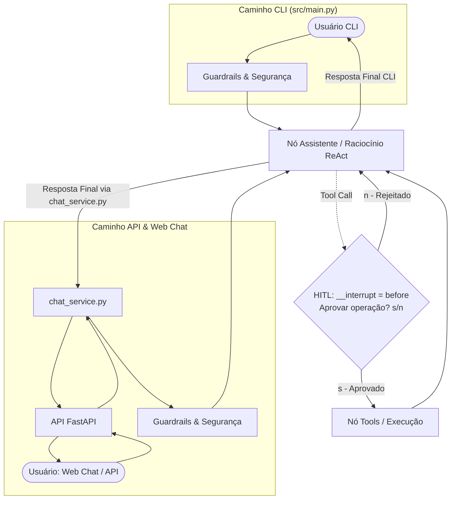

# 💳 Agente Bancário com LLM, ReAct, HITL e Ollama (v2)

<p align="center">
  
  
  
  
  
  
  
  
  
  
  
  
  
</p>

> **Desenvolvido por Marcelo Lampe Zacharias**  
> *Engenheiro de Software & Arquiteto de Sistemas (20+ anos de experiência) | Esp. em Inteligência Artificial Aplicada (UFPR) | Mestrando em Inteligência Computacional (UTFPR)*

---

## 🌟 Sobre o Projeto

Este projeto evoluiu de um agente bancário de linha de comando (CLI) para uma **arquitetura modular e limpa (`Clean Structure`)**, mantendo a execução local via **Ollama** e adicionando **API REST com FastAPI**, **camada de serviço (`chat_service.py`)**, **suíte de testes** e uma **interface web de chat em HTML e JavaScript**.

A solução combina:
- **ReAct (Reason and Act)** para raciocínio e invocação dinâmica de ferramentas financeiras.
- **HITL (Human-in-the-Loop)** para aprovação explícita de operações críticas.
- **Guardrails de Segurança** para filtragem de entradas maliciosas, *jailbreak* e comportamentos fora do escopo.
- **Múltiplas interfaces sobre a mesma lógica de negócio**: CLI, API FastAPI e Web Chat.

---

## 🧠 Arquitetura: ReAct + HITL + Guardrails

O sistema opera sob três pilares de engenharia de agentes autônomos:

1. **ReAct (Reason and Act):** O modelo LLM atua como o cérebro de raciocínio (`nó assistente`). Ele analisa a intenção do usuário, decide se precisa chamar uma ferramenta (*Tool Call* representada por `-.->`) ou se já pode responder diretamente, interpreta os retornos das ações executadas (`tools --> assistente`) e conclui a tarefa.
2. **HITL (Human-in-the-Loop):** Implementado por meio de interrupções explícitas dentro do fluxo de execução (`__interrupt = before` no nó `tools`), exigindo aprovação humana antes de efetivar operações financeiras sensíveis.
3. **Guardrails de Segurança:** Camada intermediária de proteção que analisa a entrada do usuário em busca de linguagem imprópria, tentativas de injeção de prompt (*jailbreak*) e comportamentos fora de conformidade.

### Diagrama de Arquitetura


<hr>



---

## 🔄 Principais Mudanças em `graph.py` e `chat_service.py`

A refatoração para a estrutura limpa desacoplou a orquestração do grafo e o gerenciamento de conversas/sessões das interfaces de entrada (CLI, FastAPI e Web):

### `src/agents/graph.py`
- **Organização por namespace (`src.agents.graph`):** Alinhado à nova estrutura de pacotes do projeto, facilitando o reuso pelo serviço de chat, pela API e pelos testes.
- **Separação de responsabilidades:** Focado na construção e compilação do grafo de estados com LangGraph, configuração do LLM local via Ollama, vinculação das *tools* bancárias (`src/tools/bank_tools.py`) e definição do ponto de interrupção HITL.
- **Integração com a camada de serviço:** Projetado para ser consumido por `chat_service.py` em vez de depender diretamente de loops de `input()`/`print()` da CLI.

### `src/services/chat_service.py`
- **Nova camada de aplicação/serviço:** Centraliza o fluxo conversacional do agente bancário, servindo como ponte entre as interfaces (API FastAPI e CLI/Web) e o grafo (`graph.py`).
- **Gerenciamento de sessão e estado:** Coordena o contexto da conversa, o usuário ativo, o encaminhamento de mensagens após os *guardrails* e o tratamento de interrupções/retomadas do fluxo HITL.
- **Reuso sem duplicação de lógica:** Permite que endpoints HTTP da API e fluxos interativos executem a mesma lógica de negócio e observabilidade.

---

## 📂 Estrutura de Arquivos

```text
agent_banco_v2/
├── src/
│   ├── agents/
│   │   ├── __init__.py
│   │   ├── graph.py
│   │   └── graph2.py
│   ├── API/
│   │   └── api.py
│   ├── core/
│   │   ├── __init__.py
│   │   ├── banco.json
│   │   └── database.py
│   ├── security/
│   │   ├── __init__.py
│   │   └── guardrails.py
│   ├── services/
│   │   ├── __init__.py
│   │   └── chat_service.py
│   ├── tests/
│   │   ├── __init__.py
│   │   ├── test_agent_api.py
│   │   └── test_guardrails.py
│   ├── tools/
│   │   ├── __init__.py
│   │   └── bank_tools.py
│   ├── utils/
│   │   ├── __init__.py
│   │   └── logger.py
│   ├── web/
│   │   └── index.html
│   ├── __init__.py
│   └── main.py
├── .gitignore
├── .python-version
├── agent_observabilidade.log
├── banco.json
├── extrato_operacoes.log
├── grafo_arquitetura.mmd
├── image.png
├── pyproject.toml
├── README.md
└── uv.lock
```

| Arquivo / Módulo | Descrição Técnica |
| :--- | :--- |
| **`src/main.py`** | Ponto de entrada da aplicação em modo CLI; integra o serviço/agente ao terminal, gerenciando sessões, comandos e interação do usuário. |
| **`src/agents/graph.py`** | Define o grafo principal de estados do agente bancário (LangGraph), integrando o LLM via Ollama, as *tools*, o fluxo ReAct e o ponto de interrupção HITL. |
| **`src/agents/graph2.py`** | Variante alternativa do grafo com nó explícito de classificação (*Router / Classifier Pattern*), mantendo integração com Ollama, *tools* e HITL. |
| **`src/API/api.py`** | Expõe a aplicação via **FastAPI**, fornecendo endpoints HTTP para interação com o agente bancário e gerenciamento do fluxo. |
| **`src/services/chat_service.py`** | Camada de serviço responsável por orquestrar conversas, sessões, execução do agente e respostas para API e demais consumidores. |
| **`src/core/database.py`** | Gerencia a leitura, escrita e persistência dos dados bancários (contas, usuários e saldos). |
| **`src/core/banco.json`** | Base de dados JSON utilizada pelo core da aplicação para persistência local. |
| **`src/security/guardrails.py`** | Implementa as validações de segurança (*guardrails*), filtrando linguagem imprópria, *jailbreak* e entradas fora de conformidade. |
| **`src/tools/bank_tools.py`** | Define as ferramentas (*tools*) bancárias invocadas pelo agente (consulta de saldo, saque, depósito e transferência). |
| **`src/utils/logger.py`** | Configura e gerencia os logs de observabilidade do agente e auditoria das operações bancárias. |
| **`src/web/index.html`** | Interface web simples em HTML e JavaScript para testar o chat do agente bancário conectado à API. |
| **`src/tests/test_agent_api.py`** | Testes automatizados para validar os endpoints e o comportamento da API do agente. |
| **`src/tests/test_guardrails.py`** | Testes automatizados para verificar as regras e bloqueios implementados nos *guardrails*. |
| **`banco.json`** | Arquivo JSON de dados/mock na raiz do projeto. |
| **`agent_observabilidade.log`** | Log detalhado de eventos, passos do grafo e observabilidade da execução do agente. |
| **`extrato_operacoes.log`** | Log de auditoria das operações bancárias realizadas. |
| **`grafo_arquitetura.mmd`** | Definição em formato Mermaid do diagrama de arquitetura/grafo do projeto. |
| **`pyproject.toml` / `uv.lock`** | Configuração do projeto, dependências Python e *lockfile* determinístico gerenciado pelo `uv`. |

---

## Como executar o projeto

Este projeto utiliza o [uv](https://github.com/astral-sh/uv) para gerenciamento de dependências e ambiente virtual.

### Pré-requisitos para rodar localmente

Certifique-se de ter as seguintes ferramentas e modelos instalados em sua máquina antes de prosseguir:

1. **Gerenciador de Pacotes `uv`**:
   - **Linux/macOS:** `curl -sSf https://astral.sh/uv/install.sh | sh`
   - **Windows:** `powershell -c "irm https://astral.sh/uv/install.sh | iex"`

2. **Ollama (Execução de Modelos Locais)**:
   - Baixe e instale o [Ollama](https://ollama.com/) de acordo com o seu sistema operacional.
   - Certifique-se de que o serviço do Ollama esteja rodando em segundo plano.

3. **Modelo Gemma 4b**:
   - Baixe o modelo configurado no projeto executando o comando abaixo no seu terminal:
     ```bash
     ollama run gemma4:e4b
     ```
   - *(Nota: Substitua `gemma4:e4b` pela tag exata do modelo que estiver utilizando. Você também pode usar `llama3.1:latest`, `gemma2` ou outro modelo compatível).*
   - *(Nota 2: Para boa performance local com modelos quantizados/locais, recomenda-se GPU dedicada com ao menos 8 GB de VRAM e 32 GB de RAM).*
   - *(Nota 3: Caso deseje adaptar para provedores externos como OpenAI, Gemini ou Groq, será necessário configurar chaves de API no `.env` e implementar o respectivo cliente/fallback).*

---

## ⚙️ Instalação e Execução

### 1. Clonar e Sincronizar o Ambiente com `uv`

```bash
git clone https://github.com/marcelozacha/agent_banco_v2.git
cd agent_banco_v2
uv sync
```

*(Caso esteja inicializando um ambiente do zero com Python 3.11 e `uv`):*

```bash
uv venv --python 3.11
uv sync
```

### 2. Adicionar Dependências (`FastAPI` e `Uvicorn`)

Para adicionar ou garantir as bibliotecas **FastAPI** e **Uvicorn** ao projeto com `uv`:

```bash
uv add fastapi uvicorn
```

### 3. Comandos para Rodar a Aplicação, API, Interface Web e Testes

- **Rodar a API (FastAPI + Uvicorn):**
  ```bash
  uv run uvicorn src.API.api:app --host 127.0.0.1 --port 8000 --reload
  ```

- **Rodar a Interface Web (HTML + JavaScript):**
  ```bash
  python -m http.server 5500 --directory src/web
  ```
  *(Acesse `http://127.0.0.1:5500` no navegador após iniciar a API em `http://127.0.0.1:8000`).*

- **Rodar a Aplicação em modo CLI:**
  ```bash
  uv run python -m src.main
  ```

- **Rodar os Testes da API:**
  ```bash
  uv run python -m src.tests.test_agent_api
  ```


---

## 🕹️ Comandos de Interação CLI

Durante a execução no terminal (`uv run python -m src.main`), utilize os seguintes comandos para controlar a sessão:

- **`/sair`** — Encerra a aplicação de forma segura.
- **`/usuario`** — Alterna o usuário ativo na sessão bancária.
- **HITL (`s` / `n`)** — Quando uma transação financeira for solicitada, o agente pausará a execução e aguardará sua confirmação explícita com **`s`** (aprovar) ou **`n`** (recusar).

---

## 💡 Melhorias que podem ser aplicadas

- Trocar o *saver* do agente de `MemorySaver` para persistência em banco de dados (como SQLite).
- Utilizar `UUID4` concatenado para identificação de sessões/usuários.
- Adicionar *fallback* e suporte a modelos remotos/online.
- Restringir o HITL apenas a operações que alteram dados (removendo de consultas).
- Adicionar um pipeline RAG para dúvidas sobre seguros, cartão de crédito e consórcios.
- Expandir a arquitetura modular para outras interfaces (como Gradio ou Streamlit) mantendo o núcleo compartilhado.
- Adicionar *guardrail* semântico e *guardrail* de saída (*output guardrail*) para prevenção de vazamento de PII.
- Avaliar frameworks/modelos especializados de segurança (ex.: NeMo Guardrails, Llama Guard, IBM Granite Guardian, ShieldGemma).
- Externalizar e versionar *prompts* em arquivos dedicados.