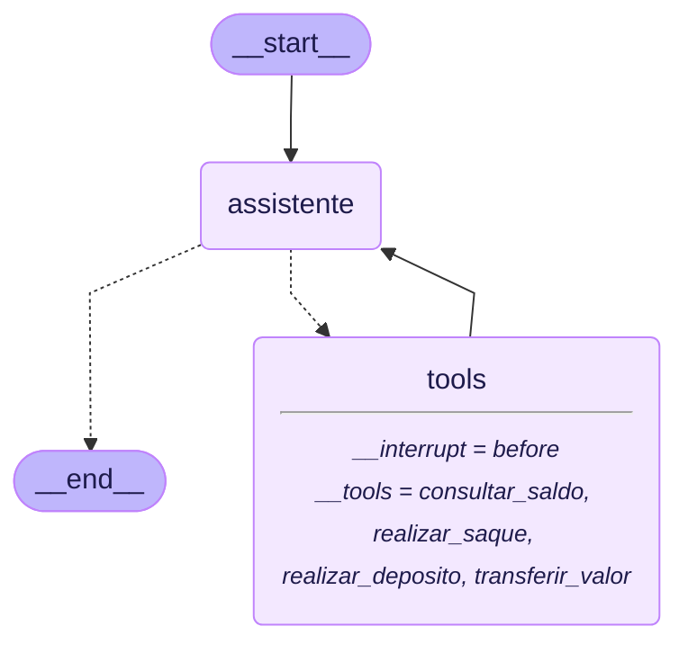
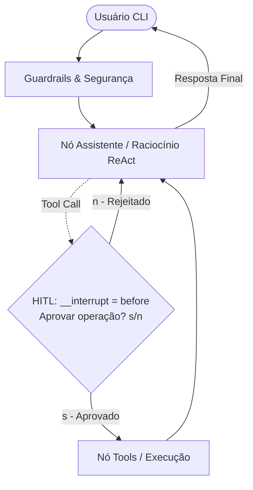

# 💳 Agente Bancário com LLM, ReAct, HITL e Ollama

<p align="center">
  
  
  
  
  
  
  
  
  
</p>

> **Desenvolvido por Marcelo Lampe Zacharias**  
> *Engenheiro de Software & Arquiteto de Sistemas (20+ anos de experiência) | Esp. em Inteligência Artificial Aplicada (UFPR) | Mestrando em Inteligência Computacional (UTFPR)*
---

## 🌟 Sobre o Projeto

Este projeto implementa um **Agente Bancário Inteligente de Linha de Comando (CLI)** totalmente integrado a modelos locais de Inteligência Artificial via **Ollama**. A arquitetura combina o padrão **ReAct (Reason and Act)** para tomadas de decisão dinâmicas com o mecanismo de **HITL (Human-in-the-Loop)** para validação humana de transações críticas, garantindo segurança, determinismo e observabilidade de ponta a ponta.

---

## 🧠 Arquitetura: ReAct + HITL + Guardrails

O sistema opera sob três pilares de engenharia de agentes autônomos:

1. **ReAct (Reason and Act):** O modelo LLM atua como o cérebro de raciocínio (`nó assistente`). Ele analisa a intenção do usuário, decide se precisa chamar uma ferramenta (*Tool Call* representada por `-.->`) ou se já pode responder diretamente, interpreta os retornos das ações executadas (`tools --> assistente`) e conclui a tarefa.
2. **HITL (Human-in-the-Loop):** Implementado por meio de interrupções explícitas dentro do fluxo de execução (`__interrupt = before` no nó `tools`), exigindo aprovação humana interativa (`s/n`) antes de efetivar qualquer operação financeira sensível.
3. **Guardrails de Segurança:** Camada intermediária de proteção que analisa a entrada do usuário em busca de linguagem imprópria, tentativas de injeção de prompt (*jailbreak*) e comportamentos fora de conformidade.

### Diagrama de Arquitetura



<hr>




---

## 📂 Estrutura de Arquivos

| Arquivo / Módulo | Descrição Técnica |
| :--- | :--- |
| **`main.py`** | Ponto de entrada do sistema; integra o grafo de estados do agente à interface de linha de comando (CLI), gerenciando sessões, entradas do usuário e observabilidade. |
| **`graph.py`** | Define o grafo de estados do agente bancário, integrando o modelo LLM (Ollama), as ferramentas (*tools*), a lógica de fluxo e o ponto de interrupção HITL. |
| **`graph2.py`** | Abordagem com Nó Explícito de Classificação (Router / Classifier Pattern). Define o grafo de estados do agente bancário, integrando o modelo LLM (Ollama), as ferramentas (*tools*), a lógica de fluxo e o ponto de interrupção HITL. |
| **`tools.py`** | Define as ferramentas executáveis pelo agente para interagir com o banco de dados (consultas de saldo, saques, depósitos e transferências). |
| **`database.py`** | Gerencia a persistência dos dados do banco em um arquivo JSON, controlando contas de usuários e saldos. |
| **`guardrails.py`** | Implementa o sistema de restrições de segurança (*guardrails*), filtrando linguagem imprópria, tentativas de *jailbreak* e comportamentos indesejados. |
| **`logger.py`** | Gerencia a observabilidade do sistema, registrando operações bancárias e eventos do agente em arquivos de log separados. |
| **`banco.json`** | Mock de banco de dados funcional para persistência e testes locais. |
| **`.log`** | Arquivos de saída para auditoria das operações e observabilidade do fluxo. |

---

## Como executar o projeto

Este projeto utiliza o [uv](https://github.com/astral-sh/uv) para gerenciamento de dependências e ambiente virtual.

### Pré-requisitos para rodar localmente

Certifique-se de ter as seguintes ferramentas e modelos instalados em sua máquina antes de prosseguir:

1. **Gerenciador de Pacotes `uv`**:
   - **Linux/macOS:** `curl -sSf https://astral.sh/uv/install.sh | sh`
   - **Windows:** `powershell -c "irm https://astral.sh/uv/install.sh | iex"`

2. **Ollama (Execução de Modelos Locais)**:
   - Baixe e instale o [Ollama](https://ollama.com/) de acordo com o seu sistema operacional.
   - Certifique-se de que o serviço do Ollama esteja rodando em segundo plano.

3. **Modelo Gemma 4b**:
   - Baixe o modelo configurado no projeto executando o comando abaixo no seu terminal:
     ```bash
     ollama run gemma4:e4b
     ```
     *(Nota: Substitua `gemma4:e4b` pela tag exata do modelo Gemma que estiver utilizando no arquivo de configuração do agente). você pode usar llama3.1:latest, gemma2 ou outro
     *(Nota2: Você vai precisar de pelos menos uma placa de vídeo rtx com 8gb vram e 32gb ram*
     *(Nota3: Você  modificar e usar interface openAI, Gemini, groq e conectar a modelos de fronteira, vai precisar de chave de API e configurar o .env, a versão atual não tem fallback então precisa implementar*

### Passo a passo

1. **Clone o repositório:**
   ```bash
   git clone https://github.com/marcelozacha/agent_banco.git
   cd seu_diretorio
	```

# Se clonar use:
```bash
uv sync
```

---

## ⚙️ Instalação e Execução

O projeto padroniza o uso da ferramenta **`uv`** para gerenciamento ultrarrápido de pacotes, compilação determinística e isolamento de ambientes virtuais Python.

### 1. Inicializar o Projeto do zero e Ambiente Virtual
```bash
# 1. Criar o diretório do projeto e entrar nele
uv init agent_banco
cd agent_banco

# 2. Criar o ambiente virtual já usando o Python 3.11 (localiza ou baixa automaticamente)
uv venv --python 3.11

# 3. Ativar o ambiente virtual no Windows (PowerShell)
.venv\Scripts\Activate
```

### 2. Instalar Dependências e Sincronizar
```bash
# 4. Instalar as dependências principais
uv pip install langchain langchain-core langchain-community langchain-ollama langgraph pydantic

# 5. Criar e sincronizar arquivos de dependências
uv sync
```

### 3. Executar a Aplicação
```bash
python main.py
```

---

## 🕹️ Comandos de Interação CLI

Durante a execução no terminal, utilize os seguintes comandos para controlar a sessão:

* **`/sair`** — Encerra a aplicação de forma segura.
* **`/usuario`** — Alterna o usuário ativo na sessão bancária.
* **HITL (`s` / `n`)** — Quando uma transação financeira for solicitada, o agente pausará a execução e aguardará sua confirmação explícita com **`s`** (aprovar) ou **`n`** (recusar).


## 💡 Melhorias que podem ser aplicadas

- Saver do agente, pode ser trocado de memorysaver para um banco de dados como sqlite, por exemplo.
- A identificação do usuário utilizar um UUID4 concatenado.
- Adicionar fallback e modelos online.
- Tirar o HITL de operações de consulta e deixar somente para operações que alteram dados.
- Adicionar um RAG para tirar dúvidas sobre seguros, cartão de crédito, consórcios
- Transformar o projeto em folders CLEAN CODE, separando namespace, e podendo separar tipos de interface como web, gradio, streamlit ou expandir para API mantend a lógica.
- Hoje esta com guardrail deterministico e de IA combinados, mas poderia adicionar um guardrail semântico.
- O guardrail atual é de input, pode ser adicionado um de output para evitar vazamentos como PII
- Pode ser usado um framework orquestrador como NeMO guardrails
- Pode ser usado modelo de guardrails locais especializados como llama guard, IBM granite guardian ou ShieldGemma, uma vantagem é terem saída simples yes/no, safe/unsafe
- Combinar técnicas de guardrail
- Separar um arquivo de prompts, que facilitaria o versionamento.